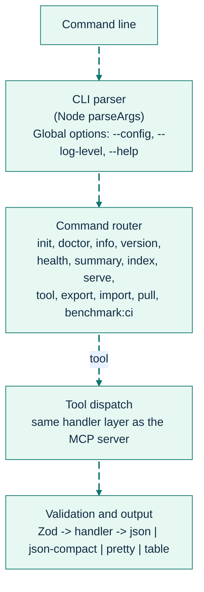

# CLI Reference

<div align="right">
<details>
<summary><strong>Docs Navigation</strong></summary>

- [Overview](../README.md)
- [Documentation Hub](./README.md)
  - [Getting Started](./getting-started.md)
  - [CLI Reference (this page)](./cli-reference.md)
  - [MCP Tools Reference](./mcp-tools-reference.md)
  - [Configuration Reference](./configuration-reference.md)
  - [Agent Workflows](./agent-workflows.md)
  - [Troubleshooting](./troubleshooting.md)

</details>
</div>

## Architecture



## Run Without Installing (npx)

If you do not want a global install, run commands through `npx`:

```bash
npx --yes sdl-mcp@latest version
npx --yes sdl-mcp@latest doctor
npx --yes sdl-mcp@latest info
```

In this document, replace `sdl-mcp` with `npx --yes sdl-mcp@latest` if you use `npx`.

## Global Options

- `-c, --config <PATH>` (explicit config file path)
- `--log-level <debug|info|warn|error>` (default: `info`)
- `--log-format <json|pretty>` (default: `pretty`)
- `-h, --help`
- `-v, --version`

Config lookup order when `--config` is omitted:

1. `SDL_CONFIG` (or `SDL_CONFIG_PATH`)
2. Local config in current working directory (`./config/sdlmcp.config.json`)
3. Global config path (default user-level location; overridable via `SDL_CONFIG_HOME`)
4. Package-local fallback (`<sdl-mcp package root>/config/sdlmcp.config.json`)

## Commands

### `sdl-mcp init`

Initialize configuration and optional client template.

```bash
sdl-mcp init --client codex --repo-path . --languages ts,py,go
sdl-mcp init -y --auto-index
sdl-mcp init -y --dry-run
```

Key options:

- `--client <claude-code|codex|gemini|opencode>`
- `--agents <comma-separated>` (multiple agent targets; selected-but-undetected targets get MCP config snippets under `~/.sdl-mcp/configs`)
- `--repo-path <PATH>` (default: current directory)
- `--languages <comma-separated>` (default: detected languages, or core built-ins when nothing is detected)
- `-f, --force`
- `-y, --yes` (non-interactive mode with repo/language auto-detection)
- `--auto-index` (run inline incremental index and doctor checks)
- `--dry-run` (print generated config without writing files)
- `--enforce-agent-tools` (generate SDL-first enforcement assets for the chosen client: enables runtime, exclusive Code Mode, and writes client-specific instruction/hook files; does not install the optional workflow skill)
- `--skill` (install the optional repo-local Codex `sdl-mcp-agent-workflow` skill)

### `sdl-mcp doctor`

Validate runtime and environment.

```bash
sdl-mcp doctor --log-level info
```

Checks include Node version, config readability, DB writability, grammar availability, native-addon availability/source/reason, and repo path accessibility.

If the graph database cannot be verified for offline inspection, dependent stale-index, extension, and retrieval-index checks are marked as skipped while independent checks continue.

### `sdl-mcp info`

Show unified runtime, config, log, Ladybug, and native-addon diagnostics.

```bash
sdl-mcp info
sdl-mcp info --config ./config/sdlmcp.config.json
```

The report includes:

- resolved config path and load status
- active log file path and whether temp-file fallback is in use
- whether console log mirroring is enabled
- Ladybug availability and active DB path
- native-addon availability, source path, and fallback reason

### `sdl-mcp index`

Index configured repository data into the ledger.

```bash
sdl-mcp index --repo-id my-repo
sdl-mcp index --watch
sdl-mcp index --force --safe-rebuild /absolute/path/to/new-graph.lbug
```

Key options:

- `--repo-id <ID>`
- `-w, --watch`
- `-f, --force` (requests a full index)
- `--safe-rebuild <PATH>` (requires `--force`; builds every configured repository in a new database)

SDL-MCP refuses an in-place full refresh when a populated repository already
exists in the active graph. Use `--safe-rebuild` with a new absolute path
instead. The command requires a stopped SDL-MCP owner, rejects `--watch` and
`--repo-id`, and requires the candidate primary and every family member to stay
absent until SDL-MCP reserves them. Appearance or replacement at any later gate
fails closed; the partial candidate is retained for diagnosis and the active
database is never opened or changed.

A successful safe rebuild waits for graph-integrity verification, checkpoints
and closes the candidate, reopens it, and validates repository membership,
physical Symbol identity, canonical string columns, dependency endpoints, and
enabled Symbol FTS. After the final close it rechecks the complete family and
atomically publishes the exact driver/storage, identity, and SHA-256 receipt
while retaining the family lease. It leaves the candidate closed and does not
update your configuration. Keep SDL-MCP stopped while you switch
`graphDatabase.path` or `SDL_GRAPH_DB_PATH`, retain the old database family for
rollback, and restart only after both path sources agree. Do not manually copy,
move, rename, or replace a database family: the receipt is a family member and
is bound to its canonical primary identity and contents.

#### LadybugDB 0.19 production cutover

The LadybugDB 0.19.0 offline qualification passed 15 behavioral phases,
including large STRING projections, checkpoint/reopen boundaries, and the
HNSW lifecycle. It is not proof of a complete upstream repair: [LadybugDB
issue #725](https://github.com/LadybugDB/ladybug/issues/725) remains open.
Run the qualification only against an offline source family before the
operator-authorized cutover:

```bash
npm run qualify:ladybug -- --source /absolute/path/to/offline-source.lbug --config /absolute/path/to/sdlmcp.config.json --expect-version 0.19.0
```

The command rejects an active database family and any filesystem alias of that
family, verifies the original offline family never changes, and retains a failed
diagnostic clone. A successful qualification deletes its disposable clone.

Use this exact cutover sequence:

1. Stop every SDL-MCP owner of the current database. Do not use the active or quarantined database as the qualification source or safe-rebuild target.
2. Choose a new, non-existent absolute path, for example `/absolute/path/to/sdl-mcp-019.lbug`, and run:

   ```bash
   sdl-mcp index --config /absolute/path/to/sdlmcp.config.json --force --safe-rebuild /absolute/path/to/sdl-mcp-019.lbug
   ```

3. Require the command's checkpoint, close/reopen, graph, string, endpoint, and index validation to succeed. It leaves the candidate closed and does not alter configuration.
4. While SDL-MCP remains stopped, atomically switch the deployment/configuration to the new path: set `graphDatabase.path` to the candidate and remove or update `SDL_GRAPH_DB_PATH` so it resolves to that same path. Do not leave the two path sources pointing at different families.
5. Start SDL-MCP and verify the configured active path. Keep the previous family intact for rollback; to roll back, stop SDL-MCP and atomically restore the prior path configuration.

Never upgrade the current or quarantined database family in place. This code
change ships the driver and safety gates only; it performs no production
rebuild or cutover.

Post-index finalization timeouts are soft reporting deadlines: the work keeps
its write slot and database-operation admission until it settles. Do not use a
timeout to start a checkpoint or manual HNSW action. SDL-MCP fences HNSW
rebuilds with exclusive admission and pre/post checkpoints.

### `sdl-mcp serve`

Start the MCP server.

```bash
sdl-mcp serve --stdio
sdl-mcp serve --stdio --dashboard-port 3001
sdl-mcp serve --http --host localhost --port 3000
```

Key options:

- `--stdio`
- `--http`
- `--host <HOST>` (default: `localhost`)
- `--port <NUMBER>` (default: `3000`)
- `--dashboard-port <NUMBER>` (stdio-only loopback observability dashboard)
- `--no-watch` (disable file watchers even when enabled in config)

HTTP binding reports process liveness, not watcher readiness. The server runs one storage preflight before any configured watcher, then marks itself ready only when every expected watcher starts. Until then, or after a startup failure, `/health` returns `503`, read-only/status requests remain available, and MCP or REST mutations fail with `STORAGE_NOT_WRITE_READY`.

When running with `--http`, additional surfaces are available:

- Graph UI: `http://<host>:<port>/ui/viewer` (`/ui/graph` redirects)
- Graph REST: new viewer facade under `/api/graph/*`; legacy `/api/graph/:repoId/symbol/:symbolId/neighborhood`, `/api/graph/:repoId/blast-radius/:fromVersion/:toVersion`, and `/api/graph/:repoId/slice/:handle` remain deprecated-compatible
- Symbol and repo helpers: `/api/symbol/:repoId/search`, `/api/symbol/:repoId/card/:symbolId`, `/api/repo/:repoId/status`, `/api/repo/:repoId/reindex`
- Observability dashboard: UI at `http://<host>:<port>/ui/observability` plus REST + SSE under `/api/observability/{snapshot,timeseries,beam-explain,stream}`. Enabled by default; toggle via `observability.enabled` in config. See [Observability Dashboard](./feature-deep-dives/observability-dashboard.md).

With `--stdio --dashboard-port <NUMBER>`, MCP traffic stays on stdio while only the observability UI/assets, `/api/observability/*`, and `/health` are exposed on `http://127.0.0.1:<NUMBER>`.

### `sdl-mcp export`

Export a sync artifact.

```bash
sdl-mcp export --repo-id my-repo --output .sdl-sync
sdl-mcp export --list
```

Key options:

- `--repo-id <ID>`
- `--version-id <ID>`
- `--commit-sha <SHA>`
- `--branch <NAME>`
- `-o, --output <PATH>` (default: `.sdl-sync/`)
- `--list`

### `sdl-mcp import`

Import a sync artifact.

```bash
sdl-mcp import --artifact-path .sdl-sync/my-repo.sdl-artifact.json --repo-id my-repo
```

Key options:

- `--artifact-path <PATH>`
- `--repo-id <ID>`
- `-f, --force`
- `--verify` (default: `true`)

### `sdl-mcp pull`

Pull by artifact selection rules, with optional fallback.

```bash
sdl-mcp pull --repo-id my-repo --commit-sha a1b2c3d --fallback --retries 3
```

Key options:

- `--repo-id <ID>`
- `--version-id <ID>`
- `--commit-sha <SHA>`
- `--fallback` (default: `true`)
- `--retries <NUMBER>` (default: `3`)

Permanent storage-integrity and populated-full-refresh refusals stop immediately
without consuming the transient retry budget.

### `sdl-mcp benchmark:ci`

Run benchmark checks in CI.

```bash
sdl-mcp benchmark:ci --repo-id my-repo --update-baseline
```

Key options:

- `--repo-id <ID>`
- `--baseline-path <PATH>` (default: `.benchmark/baseline.json`)
- `--threshold-path <PATH>` (default: `config/benchmark.config.json`)
- `--out <PATH>` (default: `.benchmark/latest.json`)
- `--json`
- `--update-baseline`
- `--skip-indexing`

Notes:

- Edge-accuracy regression checks run as part of `benchmark:ci` and compare against `scripts/benchmark/edge-accuracy-baseline.json`.
- Benchmark repo scope can be pinned via `scripts/benchmark/phase-a-benchmark-lock.json`.
- Indexing benchmarks require a fresh dedicated graph path. The command refuses
  an existing database or WAL family; repeated smoothing samples then rebuild
  only that process-owned disposable graph.

### `sdl-mcp summary`

Generate copy-paste context summaries from indexed data.

```bash
sdl-mcp summary "auth flow" --short
```

Key options:

- `--budget <NUMBER>`
- `--short|--medium|--long`
- `--format <markdown|json|clipboard>`
- `--scope <symbol|file|task>`
- `--repo <ID>`

### `sdl-mcp health`

Show composite repository health and machine-readable badge/json output.

```bash
sdl-mcp health --json
sdl-mcp health --badge
```

Key options:

- `--repo-id <ID>`
- `--json`
- `--badge`

The CLI `health` command reports repository health. It is separate from the HTTP `/health` readiness endpoint.

### Operator safety gates

Use the isolated QA runner for mutating tool tests. The runner owns a fresh stdio server and database, verifies the active path in-band, and never sends mutations to an already-running HTTP server.

```powershell
npm run qa:isolated -- --active-db <active.lbug> --fixture-root <disposable-root> --config <qa-config.json> --scenario <calls.json>
```

Use the Ladybug qualification gate before adopting a new installed `kuzu` alias. Stop the source database owner first and pass a pre-staged offline snapshot or quarantined family. The script reads the source only as bytes, tests a verified clone for two checkpoint/reopen cycles, removes successful clones, and retains failed clones.

```powershell
npm run qualify:ladybug -- --source <closed-db.lbug> --config <config.json> --expect-version <version>
```

### `sdl-mcp tool <action> [args]`

Direct MCP tool invocation from the CLI. The command currently exposes the direct action definitions from [`src/cli/commands/tool-actions.ts`](../src/cli/commands/tool-actions.ts), plus in-process metadata proxies for `action.search` and `manual` (aliases: `sdl.action.search`, `sdl.manual`). Direct graph actions reuse the gateway action map; the two metadata proxies call the same handlers registered for MCP clients and do not open the graph database.

Graph actions close the database strictly before printing a successful result,
including checkpointing and sealing its lineage receipt. Failed actions also
close the database; close failures remain errors. Background `index.refresh`
jobs require a persistent MCP session: the CLI rejects `async: true` before
opening the database.

```bash
sdl-mcp tool repo.register --repo-id my-repo --root-path . --dry-run
sdl-mcp tool repo.status --repo-id my-repo
sdl-mcp tool symbol.search --repo-id my-repo --query "handleRequest"
sdl-mcp tool symbol.edit --repo-id my-repo --mode applyNow --symbol-id "src/auth.ts::handleAuth" --expected-ast-fingerprint fp123 --expected-range '{"startLine":1,"startCol":0,"endLine":3,"endCol":1}' --operation '{"kind":"replaceBody","content":"return true;\n"}'
sdl-mcp tool slice.build --repo-id my-repo --entry-symbols sym123
sdl-mcp tool semantic.enrichment.status --repo-id my-repo
sdl-mcp tool semantic.enrichment.refresh --repo-id my-repo --dry-run
sdl-mcp tool search.edit --repo-id my-repo --mode preview --targeting text --query '{"literal":"old","replacement":"new"}' --edit-mode replacePattern
sdl-mcp tool file.write --repo-id my-repo --file-path config/app.json --json-path server.port --json-value 8080
sdl-mcp tool response.get --repo-id my-repo --handle response-myrepo-1770000000000-0123456789abcdef --raw --max-bytes 8192
sdl-mcp tool response.get --repo-id my-repo --handle response-myrepo-1770000000000-0123456789abcdef --json-path evidence[0]
sdl-mcp tool response.get --repo-id my-repo --handle response-myrepo-1770000000000-0123456789abcdef --json-path evidence --offset 0 --limit 5
sdl-mcp tool action.search --query manual --summary-only
sdl-mcp tool action.search '{"query":"manual","limit":1}' --json
sdl-mcp tool sdl.manual --actions action.search --format json
```

Key options:

- `--output-format <json|json-compact|pretty|table>` (default: `pretty`)
- `--json` (alias for `--output-format json`)
- `--repo-id <ID>` (passed through to the underlying tool)
- One positional JSON object may be supplied before flags and is merged with stdin JSON before flag overrides
- All remaining arguments are forwarded as tool parameters

The CLI parser accepts the canonical action fields plus the same common aliases accepted by MCP requests, such as `--repo-id`, `--symbol-id`, `--symbol-ids`, `--from-version`, `--to-version`, and `--slice-handle`.

Not every MCP surface is available through `sdl-mcp tool`. Only `action.search` and `manual` are currently proxied metadata tools; `sdl.context`, `sdl.retrieve`, `sdl.workflow`, and `sdl.file` remain MCP-only wrapper tools. The direct flat write actions are available as `file.write`, `search.edit`, and `symbol.edit`. CLI `symbol.edit` operates on saved files; use `applyNow` for CLI writes because preview plan handles are process-local. Overlay-aware draft edits and two-phase symbol apply require an MCP server session. Use [`CLI Tool Access`](./feature-deep-dives/cli-tool-access.md) for the current direct-action matrix.

### `sdl-mcp version`

Print version and environment.

```bash
sdl-mcp version
```

## Typical Flows

### Local Setup

```bash
sdl-mcp init --client codex
sdl-mcp info
sdl-mcp doctor
sdl-mcp index
sdl-mcp serve --stdio
```

### CI Data Sync

```bash
sdl-mcp export --repo-id my-repo --commit-sha $GIT_SHA
sdl-mcp pull --repo-id my-repo --commit-sha $GIT_SHA --fallback
sdl-mcp benchmark:ci --repo-id my-repo
```
